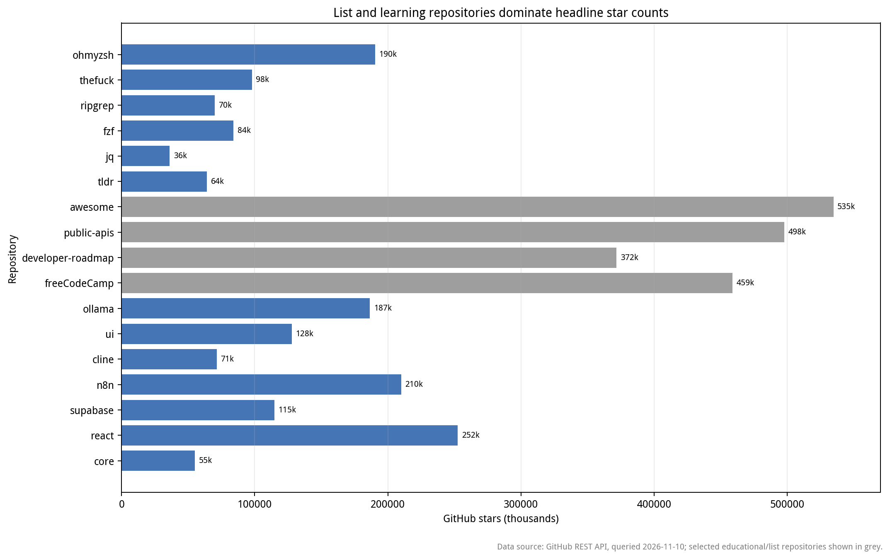
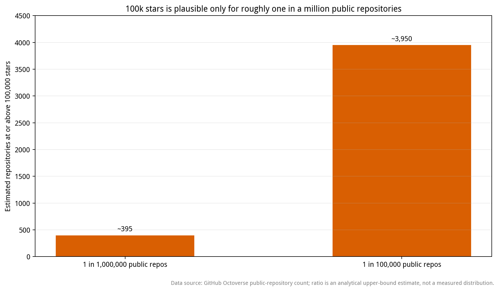

# Reaching 100,000 GitHub Stars in 2026: Distribution, Survivorship, and What an AI Trust CLI Would Actually Need

## Executive summary

A new developer CLI or tool can still reach 100,000 GitHub stars, but the honest forecast is **unlikely, not merely difficult**. The headline repositories that crossed that line are not a representative sample: many are multi-year communities, learning platforms, curated lists, or project ecosystems with large adjacent products. At the time of this report, GitHub had more than 395 million public repositories; even under the generous assumption that roughly one in 100,000 public repositories has reached 100k stars, that would imply only on the order of a few thousand such repositories—and the true ratio is plausibly nearer one in a million [1][14]. A 100k-star goal is therefore a rare-event bet, not a growth target with a known conversion funnel.

The recurring mechanism is narrower than “build something useful.” The repository must make a painful, recurring job legible in one sentence, deliver a visible result in under five minutes, and be trivial to install. Ripgrep’s speed, Oh My Zsh’s instant terminal transformation, Ollama’s local-model command, and shadcn/ui’s copy-paste components all share that structure [2][3][4][5]. A GIF, a short terminal recording, a memorable name, and a default MIT or similarly permissive license lower the friction to try, share, and reuse; they do not create demand.

For a 2026 AI-agent trust and verification tool, the realistic ceiling is not 100k stars. A specialized security or verification tool is more likely to reach roughly 1k–10k stars if it earns one credible niche use case, and perhaps 25k–60k if it becomes the reference integration for several agent runtimes. The 100k path requires more than a CLI: an ecosystem-standard evidence format, adoption by at least two major runtimes or distribution channels, a paid or foundation-grade maintenance engine, and a trust story that non-users repeat. A better success metric is the number of verified, policy-enforced production workflows per month—combined with completion of the verification loop, false-positive rate, time to remediation, and external integrations. Raw stars correlate poorly with installs, downloads, security quality, and sustainability; GitHub itself describes starring as a way to save, rediscover, and appreciate projects [6].

## 1. The 100k cohort is dominated by learning, curation, and platform repositories

The repository list in the research question spans fundamentally different artifacts. Oh My Zsh, thefuck, ripgrep, fzf, jq, and tldr are closest to the “developer tool” label, but even within that set the products differ sharply: jq is a mature language and runtime; Oh My Zsh is a configuration framework; fzf is a reusable primitive; thefuck is a novelty with memorable word-of-mouth; and tldr is a community-curated content project. Awesome, public-apis, and developer-roadmap are not executable CLIs at all. FreeCodeCamp and Supabase have substantial adjacent products, n8n is a workflow platform, and React is a framework supported by a major organization. Comparing their star totals as if they were outcomes of the same growth playbook is a category error.

Current star counts also drift daily, and search engines, vendor pages, and third-party dashboards can disagree. The figures below were obtained through the GitHub REST API on 10 November 2026 and should be read as a snapshot rather than guarantees of a repository’s long-term rank [2].

| Repository | API stars on 2026-11-10 | Repository type | 100k status and verified evidence |
|---|---:|---|---|
| ohmyzsh/ohmyzsh | 190,424 | Shell framework | Above 100k; thefuck-style name recognition and long community. Historical 100k date not verified here. |
| nvbn/thefuck | 97,950 | CLI | Below 100k at the snapshot; 100k not verified. |
| BurntSushi/ripgrep | 69,961 | CLI | Below 100k; does not satisfy the “100k” premise today. |
| junegunn/fzf | 84,119 | CLI | Below 100k; 100k date not verified. |
| jqlang/jq | 36,094 | Query language/runtime | Below 100k; not verified above 100k. |
| tldr-pages/tldr | 64,184 | Curated content | Below 100k; not verified above 100k. |
| sindresorhus/awesome | 534,667 | Curated list | Above 100k; list rather than a tool. |
| public-apis/public-apis | 497,838 | Curated list | Above 100k; list rather than a tool. |
| kamranahmedse/developer-roadmap | 371,732 | Career/learning content | Above 100k; content rather than a CLI. |
| freeCodeCamp/freeCodeCamp | 458,890 | Learning platform | Above 100k; large adjacent curriculum. |
| ollama/ollama | 186,537 | Local-model runtime | Above 100k; crossed on 7 August 2024 per a historical tracker [7]. |
| shadcn-ui/ui | 127,820 | Component distribution model | Above 100k; relies on the React/Tailwind/Radix ecosystem. |
| cline/cline | 71,496 | AI-coding editor extension | Below 100k at the snapshot. |
| n8n-io/n8n | 209,998 | Automation platform | Above 100k; reached 10,000 by November 2019 and later grew into a Top-50 GitHub project [8][9]. |
| supabase/supabase | 114,744 | Backend platform | Above 100k; Supabase announced the milestone on 2 April 2026 [10]. |
| facebook/react | 252,476 | UI framework | Above 100k; corporate backing and ecosystem, not a CLI. |
| vuejs/core | 54,899 | UI framework core | **Not verified at 100k**; do not count it as a member of the cohort. |

*Figure 1: GitHub stars for selected repositories as of 10 November 2026. The grey bars are educational or curated-list repositories, which materially distort comparisons with executable developer tools. Data source: GitHub REST API [2].*

The data table and chart are available as [downloadable CSV](data_repository_stars.csv).

The headline figure is that only nine repositories in the requested list are verified above 100k stars in the current snapshot, and several of those are content or platform projects. Thefuck, ripgrep, fzf, jq, tldr, Cline, and vuejs/core are not verified at 100k today. Treating the full question list as seventeen comparable “100k developer tools” would overstate the prevalence of the outcome by roughly a factor of two.

## 2. The common product design is a short latency between comprehension and proof

The repositories that did reach 100k tend to answer the question “what does this do?” before the reader has scrolled. Ripgrep’s README immediately states that it recursively searches while respecting `.gitignore` and supports Windows, macOS, and Linux; Oh My Zsh opens with a one-line identity and an install command [3][11]. These projects do not require a white paper, a philosophical justification, or a long explanation of the developer’s pain. They substitute an observable artifact—speed, a visible UI change, a transformed command, or a working example—for explanation.

**The first run must be the demonstration, not a prerequisite for the demonstration.** Zero-config tools reduce three costly steps: discovering dependencies, editing configuration before obtaining value, and diagnosing environment drift. Ripgrep defaults are deliberately opinionated: it skips hidden and binary files while respecting ignore rules, which gives a useful result without manual setup [3]. Oh My Zsh provides both `curl` and `wget` install paths [11]. shadcn/ui succeeded partly because it does not force the user to consume an opaque component package; the component source is copied into the application [5]. This is not universally superior—library consumers often prefer a stable, upgradable dependency—but it lowered the first-time comprehension cost.

Portability is a compounding force. Ripgrep ships first-class support for the three major desktop operating systems [3]. Ollama’s appeal was encapsulated in a minimal command sequence: install, pull, run [7]. A specialized 2026 CLI that requires Docker, a particular shell, Linux-only features, or a cloud account before demonstrating value has already lost most of its potential audience. Portability is especially important for a trust product: security teams must be able to run the check locally, in CI, in a developer container, and on a laptop without creating a new privileged cloud control plane.

**A memorable name is distribution infrastructure, not marketing fluff.** “thefuck” is uniquely easy to describe aloud, retell, and turn into a story. “Oh My Zsh” sounds like a reaction. “Ripgrep” immediately names the old alternative and the new category. “Ollama” and “shadcn/ui” are less funny but short and visually distinctive. A name is especially valuable when the listener cannot easily paste a link: conference hallway chats, podcasts, YouTube narration, and non-English communities all depend on recall.

A demo GIF or terminal recording converts a technical claim into something a non-user can forward. But the demo must show the result, not just the product surface. A recording of a menu opening is weak; a recording that shows a wrong command being corrected, a search returning instantly, or an agent request being blocked with an auditable reason can be repeated without commentary. The demo is not the marketing asset—it is the product’s contract.

## 3. Virality follows a sequence of distribution handoffs

GitHub is not a discovery engine. A repository becomes visible when someone outside GitHub validates it and then sends a motivated audience back to the page. The recurring external channels are Show HN and Hacker News front-page discussion, X/Twitter, Reddit, dev.to and similar long-form developer publications, YouTube tutorials, and newsletters. None of these channels is magic; each works only when the post hands the reader a concrete artifact rather than an abstract value statement.

n8n’s own account is unusually explicit. Its founder shared the repository on alternative-to and Quora, received issues and pull requests, and then used Product Hunt and Hacker News only after the product was ready for a broader audience [8]. Cline’s public retrospective reports 5 million editor installs, 57,000 GitHub stars, and more than 35 team members; it also reports that Memory Bank came from the community [12]. Those two cases illustrate the same funnel: small private validation, a public launch to a developer audience, content that demonstrates use, and a growing base of external contributors.

**The correct launch order is niche proof, then cross-posting, then ecosystem integration.** A Show HN post with a working demo and a clear “why now” argument can create an early burst, but it does not establish persistence. The next handoff is a Reddit or specialist-forum thread where practitioners describe real workflows. Then comes a written technical piece that explains a design decision, followed by a YouTube walkthrough, a newsletter mention, and finally integrations that create recurring inbound links. n8n’s growth was tied to integrations and nodes, while Cline grew through editor marketplaces, editor compatibility, and contributions from users with concrete requirements [8][12].

A 2026 launch should expect to be evaluated against AI-agent noise. Generic “bring trust to AI” copy will be filtered out. The title must name a failure scenario, such as an agent reading secrets from environment variables, installing an untrusted package, or modifying production data without approval. A post that says “agents are risky; use our tool” is an opinion. A post that says “here is the exact command an agent ran, here is the policy it violated, and here is the artifact we generated” is a product.

## 4. Documentation, licensing, and contributor design determine whether traffic converts

README quality matters because it controls the first conversion: visitor to user. A high-quality README contains a one-sentence explanation, an observable outcome, installation instructions, a minimal command, expected output, an explicit statement of what the tool does not do, license information, and contribution guidance. The goal is not aesthetic packaging. It is to reduce the number of decisions the reader must make before seeing the product work.

The README must also state operating requirements and failure modes. For a CLI, that includes supported operating systems, shells, architectures, network access, minimum versions, and destructive commands. For a trust tool, it must state whether the check is advisory or enforced, where the policy runs, whether it can be bypassed, and how its output is recorded. If a README claims “verification” but the tool cannot actually prevent the operation, the mismatch will surface immediately in issues and destroy the very asset the project is selling.

**Permissive licensing lowers friction for both reuse and enterprise review.** Oh My Zsh, thefuck, Ollama, shadcn/ui, and Cline use MIT or Apache-2.0 licensing in the current snapshot [2]. Ripgrep is dual-licensed under MIT or the Unlicense [3]. These choices make copying code, integrating a component, and conducting legal review easier. They do not, by themselves, determine long-term maintenance: permissive licensing can also make commercial forks easier. A new project should choose a standard OSI-approved license rather than an ambiguous custom terms file, because “free to read” is not the same as “free to modify or redistribute.”

Contributor conversion has three stages: a non-team user opens an issue, a second user reproduces it, and an outside contributor submits a pull request. The contributor funnel must therefore be engineered: a clear `CONTRIBUTING.md`, a `good first issue` set, reproducible development environment, tests, linting, security policy, codeowners, and visible issue triage. Cline’s retrospective illustrates why this matters: external contributors built one of the most-used features and later joined the team [12]. The underlying mechanism is not community growth for its own sake; it is turning users with immediate needs into maintainers who reduce the project’s bottleneck.

## 5. The maintenance burden is the part most launch retrospectives omit

Short-term growth and long-term survival are different products. Ripgrep remains useful because its core contract—recursive search with sensible defaults—does not require continuous reinvention. Oh My Zsh has spent years managing plugins and themes. Supabase, n8n, Cline, and Ollama all became companies or commercial platforms; their star counts cannot be separated from hiring, customer support, funding, enterprise distribution, and hosted products.

A security and verification tool faces a particularly expensive maintenance trajectory. It must track new agent protocols, shell behavior, package ecosystems, cloud permissions, and language-specific execution models. A single incorrect policy can cause data loss or create a false sense of safety. A vague advisory tool can survive as a personal project; a tool that claims enforcement needs threat models, vulnerability disclosure, compatibility tests, signed releases, dependency maintenance, and a credible response time for security reports.

**A 100k-star CLI eventually becomes an integration platform whether its author wants one or not.** Ripgrep was adopted by other developer tools. fzf became a primitive embedded in shell workflows. shadcn/ui spread through component ecosystems. Once external projects depend on an interface, deprecations create user-visible cost. For an AI-trust project, this burden is heavier because agents change rapidly: protocol upgrades, model behavior, host permissions, and supply-chain conventions can invalidate assumptions in months rather than years.

The funding question should therefore be decided before launch. A sustainable project needs a clear boundary between the open-source core and any commercial offering, a governance model, release ownership, and a response plan for maintainer burnout. The absence of these structures does not prevent a launch; it determines how quickly the project collapses after the first wave of attention.

## 6. Survivorship bias makes the denominator far smaller than the cohort suggests

GitHub reported more than 180 million accounts, over 230 new repositories per minute, and nearly one billion commits pushed in the year covered by Octoverse 2025 [1]. The platform reported 630 million total repositories, including 121 million new repositories and 395 million public or open-source repositories [1]. These are not measures of active developers, unique humans, or unique projects: accounts can be duplicate, dormant, or non-human, and the same project can appear across forks and mirrors. Nevertheless, 395 million public repositories is a reasonable denominator for an order-of-magnitude estimate.

There is no public, authoritative list of every repository ever above 100k stars, and GitHub does not publish a denominator of “repositories that set out to be developer tools.” The estimate below therefore uses public repositories, not newly created projects or active projects.

*Figure 2: Order-of-magnitude estimate based on 395 million public repositories [1]. The chart shows two plausible upper-bound assumptions, not measured counts. Data source: GitHub Octoverse and an analytical calculation.*

The corresponding estimate file is available as [downloadable CSV](data_100k_estimate.csv).

**The conservative estimate is on the order of one in one million public repositories, and certainly no more common than one in one hundred thousand.** If 395 million public repositories are divided by one million, the result is 395 repositories at 100k. If the ratio is one in 100,000, the result is 3,950. The true answer is unknown and could be smaller still because many public repositories are forks, duplicates, abandoned experiments, spam, or empty projects rather than credible attempts to build a popular tool. “On the order of one in one million” is a deliberately wide estimate, not a false precision.

The numerator is also not all success stories. A repository can reach 100k through memetic appeal, translation, or a large adjacent audience without becoming a durable tool. Conversely, a security CLI may be deployed across thousands of enterprises while receiving relatively few stars because procurement, not individual developers, drives adoption. Stars measure a particular kind of public attention; they do not measure installs, production usage, user retention, or engineering quality.

## 7. A 2026 AI-agent trust CLI faces a narrower audience and a more expensive claim

AI-agent verification is both timely and structurally difficult. The relevant audience is not “every developer.” It is a smaller set of platform engineers, security engineers, and AI-tooling builders who can enforce policy where agents run. Their requirements are stricter than those of casual CLI users: auditable evidence, low latency, safe defaults, minimal new permissions, and predictable failure behavior. A tool that merely produces a report will be ignored; an enforcement tool that blocks the wrong command will be removed.

For this category, **trust is a prerequisite and distrust is the default response**. The product must therefore show what it cannot do, how its evidence is generated, and how it can be verified independently. A memorable name and a GIF can create the first visit, but a CISO, security engineer, or senior developer will ask where the policy executes, who can alter it, whether the tool has access to secrets, and what happens when the agent runtime is compromised. These questions cannot be answered by stars, testimonials, or screenshots.

The competitive landscape also contains overlapping claims. Agent hosts, identity providers, cloud platforms, and security vendors can ship similar controls inside their own products. An independent project must offer a reason to exist outside any one vendor’s ecosystem. The most credible wedge is a runtime-neutral evidence format and enforcement primitive that works across local shells, CI, GitHub Actions, and multiple agent hosts. A narrow, defensible wedge is more plausible than a broad “agent firewall.”

## 8. What would have to be true for 100k stars to become plausible

A 100k outcome is not impossible, but it requires six conditions to hold simultaneously.

1. **The tool must solve a mass problem, not a theoretical one.** It should protect a common operation that agents already perform at scale, such as reading secrets, modifying files, running shell commands, accessing production, installing dependencies, or performing irreversible web actions. The failure must be reproducible and comprehensible in one example.
2. **The first demonstration must not require the user’s own model.** A visitor should be able to clone, install, and replay a policy violation using an included sample agent trace or mock harness. If the user must supply an API key, an account, and a suitable model before seeing value, the funnel collapses.
3. **The trust guarantee must be falsifiable.** The README, test suite, and release notes should contain deliberately blocked examples, expected exit codes, policy configuration, and evidence artifacts. An external security team should be able to reproduce the claim without trusting marketing copy.
4. **The project must become an integration standard.** This means a documented CLI interface, an SDK or library interface, GitHub Action, pre-commit or CI integration, at least two agent-host integrations, and an evidence schema that other projects can adopt. Distribution must come from tools that embed it, not only from social posts.
5. **The project needs multi-maintainer capacity.** It should have paid maintainers, a foundation or corporate backer, or a revenue model that supports security response, compatibility testing, and documentation. A solo maintainer may achieve a 1k–10k launch; a 100k outcome normally requires an organization that can survive growth.
6. **It needs a stronger distribution moment than another launch post.** The most plausible triggers are an official integration with a major agent host, an industry incident that makes the failure visible, an adjacent platform’s endorsement, or a vendor-neutral specification that becomes a dependency for other tools.

If all six conditions are met, 100k becomes a low-probability but coherent outcome. If only the first three exist, the realistic target should be 5k–25k stars and a defensible niche product. If the project is only advisory, requires a cloud account, and offers an unverifiable trust claim, it should not plan around virality.

## 9. The right target is verified production enforcement, not a star count

A CLI can receive stars from people who never run it, while a security product can be operationally important to a small number of organizations. The appropriate leading indicators are those that cannot be created by a launch announcement.

| Metric | What it measures | Why it is better than stars |
|---|---|---|
| Verified policy-enforced runs per month | Active use after installation | Measures production value rather than bookmarking |
| Completion rate of the verification loop | Whether the tool can see and decide before action | Detects broken or bypassed enforcement |
| False-positive and false-negative counts | Trustworthiness of the policy | Directly measures the core value proposition |
| Time from release to policy update | Maintenance health | Shows whether the project can keep up with agent changes |
| External integrations | Ecosystem reach | Measures durable distribution, not one-time traffic |
| Contributors with merged code and issues from non-team users | Community depth | Harder to manufacture than starring |
| Time to remediation for disclosed issues | Safety credibility | Essential for a verification product |

For a 12-month plan, the targets should be concrete and limited. An early benchmark might be 100 verified installations, 1,000 policy-enforced runs, at least three reproducible blocked-action examples, and one external integration. The next stage might be 1,000 installations, 25,000 runs, a stable evidence format, and integrations with two agent runtimes or CI environments. Star counts can be tracked as a lagging visibility metric, but they should not be the gate for funding, roadmap decisions, or continued work.

The choice of ceiling should be explicit. For a focused trust and verification CLI, 25k–60k stars over two to four years is an ambitious but reasonable objective if the integration flywheel works. Above that, the most plausible route is to become a vendor-neutral specification, runtime, or control layer used by multiple ecosystems. Raw popularity without those conditions is not a credible strategy.

## 10. Prioritized go-to-market checklist

1. **Write the one-sentence job before writing launch copy.** Complete: “When an agent tries to `<action>`, our CLI `<verifies or blocks>` using `<evidence>` without `<undesirable trade-off>`.“
2. **Build an offline replayable demo first.** Include one safe trace and one policy-violating trace so visitors can see the result without an API key, cloud account, or model.
3. **Make the first install one command.** Support macOS, Linux, and Windows where possible. Use a package manager where it reduces friction, but also provide a direct release binary.
4. **Make the README self-contained.** Include the one-liner, demo recording, install command, sample command and output, limitations, threat model, license, and contribution instructions above the fold.
5. **Define the trust boundary in plain language.** State whether enforcement is local or remote, who can change policy, where evidence is stored, and what bypass paths exist.
6. **Ship falsifiable examples on day one.** Publish exact inputs, expected verdicts, exit codes, and evidence files. Security claims without reproducible counterexamples are not marketing assets.
7. **Choose a standard permissive license and prepare governance.** Use MIT, Apache-2.0, or another OSI-approved license; add a `SECURITY.md`, codeowners, vulnerability policy, and release-signing plan.
8. **Start with one narrow integration, then expand.** Select the runtime or workflow where policy can actually block an action: a local agent shell, GitHub Actions, or one editor runtime.
9. **Sequence distribution as proof then audience.** Validate with five to ten practitioners, publish a technical deep dive, post once to the most relevant Hacker News or Reddit audience, then seek integration partners and newsletter or YouTube explainers.
10. **Never buy stars or trade engagement.** GitHub prohibits inauthentic interactions, rank abuse, automated starring or following, and incentive schemes that compromise integrity [13]. It would also destroy the credibility of a trust product.
11. **Track leading usage metrics weekly.** Measure verified runs, completion rate, false positives and negatives, remediation time, external integrations, and outside contributor activity.
12. **Set a pre-agreed sunset test.** If the tool does not have repeat use, a second independent deployment, or an external integration within a defined period, narrow the scope or pivot rather than purchasing visibility.

## Conclusion

The evidence does not support treating 100,000 stars as a normal open-source goal in 2026. The repositories that reached it are heterogeneous, often benefited from massive adjacent products or content distribution, and in some cases are not tools at all. The recurring lesson is that distribution follows a product people can immediately understand, rapidly demonstrate, and repeatedly use; it does not follow a repository merely because it is open source or addresses a fashionable category.

For an AI-agent trust and verification CLI, the highest-probability path is to win a narrow enforcement job, make the guarantee independently reproducible, and become an integration dependency for multiple runtimes. The ambitious but realistic aspiration is a vendor-neutral evidence and control layer, not a viral novelty. If the project reaches 100k stars while doing that work, stars will be a consequence; if it pursues stars instead of trust, it will neither earn popularity nor deserve it.

## References

[1] https://github.blog/news-insights/octoverse/octoverse-a-new-developer-joins-github-every-second-as-ai-leads-typescript-to-1/
> “Developers created more than 230 new repositories every minute... pushed nearly 1 billion commits in 2025.”

[2] https://docs.github.com/en/rest/repos/repos?apiVersion=2022-11-28
> “The repository object returned from the GitHub REST API includes the `stargazers_count` field.”

[3] https://github.com/BurntSushi/ripgrep
> “ripgrep recursively searches directories for a regex pattern while respecting your gitignore.”

[4] https://ohmyz.sh/
> “Oh My Zsh is a delightful, open source, community-driven framework for managing your Zsh configuration.”

[5] https://ui.shadcn.com/
> “Copy and paste. Components you can actually edit.”

[6] https://docs.github.com/en/get-started/exploring-projects-on-github/saving-repositories-with-stars
> “You can star repositories and topics to keep track of projects you find interesting and discover related content in your news feed.”

[7] https://gitstarclub.com/en/ollama/ollama
> “100k first reached 2024-08-07.”

[8] https://n8n.io/blog/celebrating-n8n-second-anniversary
> “The n8n repository gathered 5,000 stars only five months after publishing and 10,000 stars by November 2019.”

[9] https://n8n.io/
> “Our 190.2k stars place us among the most popular projects.”

[10] https://supabase.com/blog/100000-github-stars
> “We hit 100,000 GitHub stars!!”

[11] https://ohmyz.sh/
> “Install oh-my-zsh via curl. Install oh-my-zsh via wget.”

[12] https://cline.ghost.io/5m-installs-1m-open-source-grant-program/
> “Memory Bank is a good example of how this works. The community built it, validated it, and turned it into one of our most-used features.”

[13] https://docs.github.com/en/site-policy/acceptable-use-policies/github-acceptable-use-policies
> “We do not allow... inauthentic interactions, such as fake accounts and automated inauthentic activity; rank abuse, such as automated starring or following.”

[14] https://github.blog/news-insights/octoverse/octoverse-a-new-developer-joins-github-every-second-as-ai-leads-typescript-to-1/
> “We saw record-level activity across repositories, pull requests, and code pushes.”

[15] https://www.shadcndeck.com/blog/rise-of-shadcn-ui-2026
> “shadcn/ui went from a side project to 115,000+ GitHub stars in under three years.”

[16] https://freecodecamp.org/news/freecodecamp-2021-review-budget-usage-statistics
> “The community has now published more than 8,000 tutorials on topics ranging from cloud computing to coding your own guitar effect pedals.”
